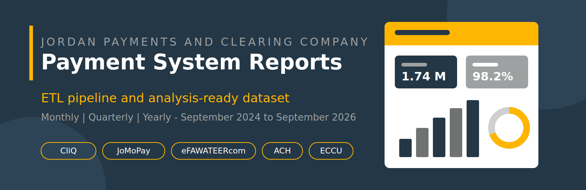

<p align="center">
  
</p>

# JoPACC Payment System Reports: Datasets and Analysis

Analysis-ready datasets built from the payment system reports published by the **Jordan Payments and Clearing Company (JoPACC)**, covering **September 2024 to September 2026**. The work is a warm-up exercise for the DA&BI internship, prepared before the Executive Monthly Report (EMR) project and handed over to the data team.

## Datasets

The final datasets are in [`dataset/`](dataset/). Each workbook has a `README` sheet that explains its layout and a raw data sheet that every other sheet reads from.

| File | Report type | Coverage | Raw data sheet |
| --- | --- | --- | --- |
| [`JoPACC_Monthly_Reports.xlsx`](dataset/JoPACC_Monthly_Reports.xlsx) | Monthly | 24 reports, Sep 2024 to Aug 2026 | `Raw Data` |
| [`JoPACC_Quarterly_Report.xlsx`](dataset/JoPACC_Quarterly_Report.xlsx) | Quarterly | 8 reports, Q3 2024 to Q2 2026 | `Data` |
| [`JOPACC_Yearly_Structured.xlsx`](dataset/JOPACC_Yearly_Structured.xlsx) | Yearly | 2024 and 2025 | `Data_All` |

**Payment systems covered:** CliQ, JoMoPay, eFAWATEERcom, ACH, ECCU, plus the combined Instant Payments (IPS) and CliQ and JoMoPay interoperability views.

### How the workbooks are organized
- One sheet per payment system, with one metric per row and the periods running across the columns.
- Every figure on those sheets is a `SUMIFS` formula over the raw data sheet, so adding or correcting rows in the raw sheet updates the whole workbook.
- The raw data sheet is a tidy, long table with columns such as `report_period`, `system`, `page`, `content_type`, `metric`, `dimension_L1`, `dimension_L2`, `event_period`, `value`, `unit` and `raw_text` (the original text as printed in the report).
- Counts and JOD values are stored as raw numbers, not as "M" or "B" text. Percentage rows are true percentages in the monthly and quarterly workbooks. In the yearly workbook they are stored as numbers (61.0 means 61.0%).

### Known limitations
- The monthly data was reconciled programmatically across reports whose layouts changed over time, so spot-check a few months against the source PDFs before relying on them for decisions.
- Monthly ACH figures come from each report's trailing trend-chart point, because the source reports have no ACH category breakdown.
- Monthly Instant Payments data starts in January 2025.
- In the quarterly data, the eFAWATEERcom "Government Service" value is inconsistent between consecutive source reports.

## Repository structure

```
assets/      Banner image used in this README
dataset/     Final monthly, quarterly and yearly workbooks
docs/        Project documentation, decks, data dictionary and gap analysis
etl/         First-pass Python extraction pipeline (kept for reference)
workbooks/   First-pass output: one workbook per source PDF
```

### Documentation highlights
- [`docs/jopacc_data_dictionary.pdf`](docs/jopacc_data_dictionary.pdf): field and metric definitions
- [`docs/JoPACC_2024_2025_Report_Gap_Analysis.pdf`](docs/JoPACC_2024_2025_Report_Gap_Analysis.pdf): gaps in the reports' own analysis and commentary
- [`docs/Map_to_EMR_Project_Documentation_v8.docx`](docs/Map_to_EMR_Project_Documentation_v8.docx): team documentation of the Map to EMR study

## First-pass ETL pipeline

The first extraction attempt is in [`etl/`](etl/). It renders and OCRs the report PDFs and writes one workbook per report into [`workbooks/`](workbooks/). It produced unreliable values in places, so the final datasets above come from a second, restructured extraction in which each report type was studied separately and then normalized to one common format. See [`etl/README.md`](etl/README.md) and [`etl/PROGRESS.md`](etl/PROGRESS.md) for how the pipeline works and its known issues.

```bash
cd etl
pip install -r requirements.txt      # also requires Tesseract OCR
python -m jopacc_etl --config config/config.yaml inventory
python -m jopacc_etl --config config/config.yaml run --workers 1
```

## Team

Three interns on the DA&BI internship, each owning one report type:

| Member | Report type |
| --- | --- |
| Emam | Yearly |
| Karmah | Quarterly |
| Naser | Monthly |

## Source

All figures come from the public payment system reports published by JoPACC. The raw report PDFs are not included in this repository.
